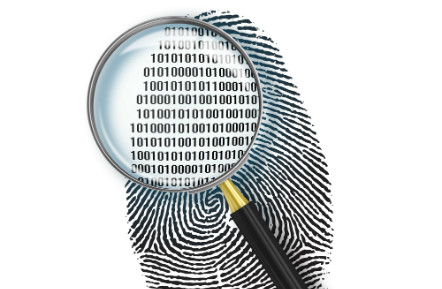
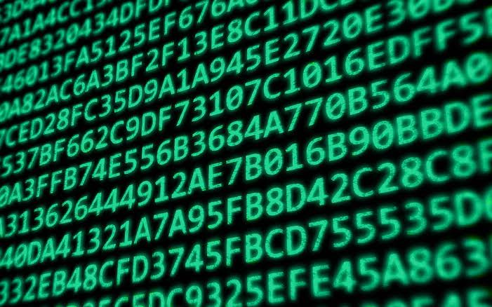
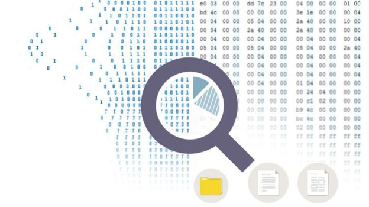
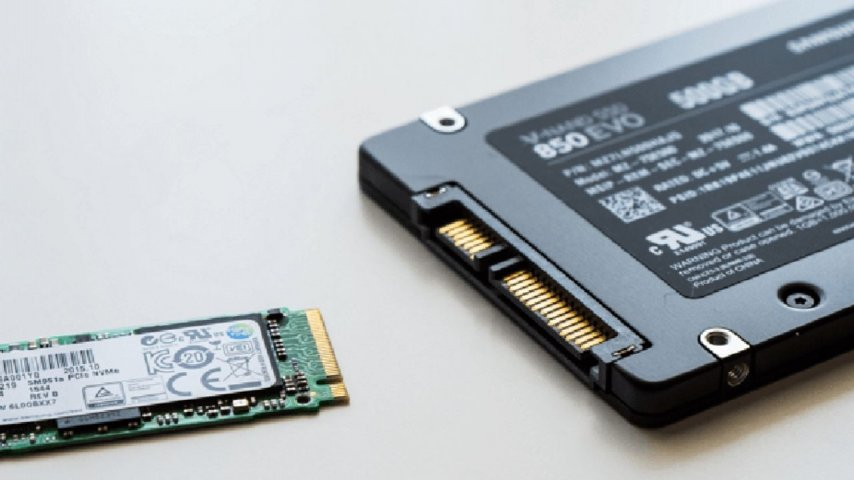

# **Silinmiş Bir Dosyanın Peşinde: Dijital Delil Kurtarma Senaryosu**

## **Bir dosya gerçekten silindiğinde ortadan kaybolur mu?**

Artık ihtiyaç duymadığımız bir dosyayı sildiğimizde birkaç saniye içinde ondan kurtulduğumuzu düşünürüz. Geri Dönüşüm Kutusu'nu boşaltır, dosyanın adını aratır, bulamayınca da tamamen yok olduğuna inanırız. Oysa silme işlemi dosyanın içeriğini aynı anda ortadan kaldırmaz.

İşletim sistemi genellikle dosyanın kapladığı alanı yeniden kullanılabilir olarak işaretlemekle yetinir. İçerik, üzerine yeni veri yazılana kadar depolama aygıtında durur. Adli bilişim (digital forensics) bu kalıntılarla çalışır: bir olayı aydınlatabilecek dijital izleri inceler, silinmiş dosyaların kurtarılması da bu işin bir parçasıdır. Amaç yalnızca dosyayı geri getirmek değil. Dosyanın gerçekten var olup olmadığı, ne zaman oluşturulduğu, hangi izleri bıraktığı ve elde edilen verinin güvenilirliği de ortaya konmalıdır.

Aşağıda silinmiş bir belgenin peşine düşüyoruz. Dosya sisteminin nasıl çalıştığına bakacak, adli bilişim uzmanlarının bu tür durumlarda hangi yöntemlere başvurduğunu izleyeceğiz.

---

## **1. Ortadan Kaybolan Dosya**

Bir şirketin bilgisayarında şüpheli bir veri sızıntısı yaşandığını düşünelim. Çalışanlardan birinin, kurum içinde saklanan gizli belgeleri dışarı aktardığından şüpheleniliyor.

İlk incelemelerde çalışanın bilgisayarında önemli bir belge bulunduğu öğreniliyor. Bilgisayar incelenmek istendiğinde ise belgenin silindiği fark ediliyor. Dosyanın adı gizli_rapor.docx olsun.

Çalışan dosyayı sildiğini ve artık bilgisayarında bulunmadığını söylüyor. Bu, ekibin işini kolaylaştırmıyor. Cevaplanması gereken sorular şunlar:

- Dosya gerçekten silinmiş mi, yoksa başka bir konuma mı taşınmış?
- İçeriği hâlâ depolama aygıtında duruyor mu?
- Dosya ne zaman oluşturulmuş, ne zaman değiştirilmiş?
- Silinmesinden sonra aynı alana yeni veri yazılmış mı?
- Kurtarma mümkün değilse varlığı başka izlerden doğrulanabilir mi?
Bu soruların cevabı için önce silme işleminin teknik olarak nasıl gerçekleştiğine bakmak gerekiyor.

---

## **2. Bir Dosya Silindiğinde Gerçekte Ne Olur?**

Bir dosyayı sildiğimizde işletim sistemi çoğunlukla içeriği depolama aygıtından hemen temizlemez. Dosya sistemindeki kayıtları günceller ve ilgili alanı yeniden kullanılabilir olarak işaretler.

Dosya sistemi (file system), bir depolama aygıtındaki dosyaların nasıl saklanacağını, adlandırılacağını ve yönetileceğini belirleyen yapıdır. Windows'ta NTFS, Linux'ta ext4, macOS'ta APFS buna örnektir. Dosya sistemi yalnızca içeriği değil, dosyanın adını, boyutunu, konumunu, zaman bilgilerini ve diğer özelliklerini de kayıt altında tutar.

NTFS'te bu kayıtlar MFT (Master File Table) adı verilen yapıda durur. Bir dosya oluşturulduğunda ona ait bilgiler MFT içinde bir kayıtla eşleştirilir. Dosya silindiğinde ilgili MFT kaydı genellikle boş olarak işaretlenir ve yeniden kullanılabilir hâle gelir. Ne kayıt ne de dosya içeriği aynı anda yok olur.

Bu yüzden uzman, silinmiş bir dosyanın izini ararken yalnızca dosyanın bulunduğu klasöre bakmaz. Dosya sisteminin geride bıraktığı kayıtları da inceler. Burada bir ayrıntı var: kaydın duruyor olması, içeriğin de kurtarılabileceği anlamına gelmez. Dosyanın veri blokları başka veriler tarafından üzerine yazılmış olabilir.

---

## **3. Dijital Delilin Korunması**

Senaryomuza dönelim. Ekip, şüpheli çalışanın bilgisayarını incelemek üzere teslim alıyor. İlk iş doğrudan bilgisayarı açıp dosya aramak değil.

Dijital deliller hassastır; sıradan işlemler bile veriyi değiştirebilir. Bilgisayarın açılması, işletim sisteminin çalışması, geçici dosyaların oluşması ya da otomatik güncellemeler mevcut veriyi etkiler. Bu yüzden ilk hedef durumu mümkün olduğunca korumaktır.

Bunun için adli disk imajı (forensic disk image) alınır. Disk imajı, bir depolama aygıtının inceleme amacıyla çıkarılan kopyasıdır. Standart bir dosya kopyasından farklı olarak, uygun yöntemle alındığında yalnızca görünen dosyaları değil ayrılmamış alanları (unallocated space), dosya sistemi kayıtlarını ve ilgili diğer alanları da içerir.

32 GB kapasiteli bir USB bellekte yalnızca 5 GB görünür dosya olsa bile imaj, kullanılan ve kullanılmayan alanları kapsayacak şekilde alınabilir. Böylece silinmiş dosyaların kalıntılarının araştırılacağı bir inceleme ortamı hazırlanır.

İşlem sırasında mümkün olduğunda yazma engelleyici (write blocker) kullanılır. Bu, incelenen aygıta veri yazılmasını önleyen donanım veya yazılım tabanlı bir mekanizmadır. Orijinal delilin değişmemesi buna bağlı.

---

## **4. Hash Değerleri**

İmaj oluşturulduktan sonra bütünlüğü doğrulamak için hash hesaplanır. Hash fonksiyonu, herhangi bir uzunluktaki veriyi belirli uzunlukta bir özet değere dönüştürür. SHA-256, girdisinden 256 bit uzunluğunda bir değer üretir.

Aynı veri tekrar işlendiğinde aynı hash elde edilir. Verideki küçük bir değişiklik ise genellikle tamamen farklı bir değer ortaya çıkarır. Ekip imajı aldıktan sonra SHA-256 değerini hesaplar, ardından inceleme kopyasında aynı işlemi tekrarlar. İki değer eşleşiyorsa imajın oluşturulmasından sonraki süreçte içeriğinin değişmediğine dair güçlü bir doğrulama elde edilmiş olur.

Bu eşleşme tek başına imajın kaynağının doğru olduğunu ya da delilin elde edilme sürecinin baştan sona hatasız geçtiğini kanıtlamaz. Delilin nasıl teslim alındığı, nasıl kopyalandığı ve kimler tarafından işlendiği de belgelenmeli. Bu sürece delil zinciri (chain of custody) denir: bir delilin ilk elde edildiği andan raporlamaya kadar kimin kontrolünde bulunduğunu ve hangi işlemlerden geçtiğini kayıt altına alır. Adli bilişimde doğru veriyi bulmak yetmez; bulunan verinin güvenilir olduğunu da göstermek gerekir.

---

## **5. Silinmiş Dosyayı Aramak**

Elimizde artık orijinal diske dokunmadan inceleyebileceğimiz bir disk imajı var. Hedef, gizli_rapor.docx dosyasının izlerini bulmak.

Önce dosya sistemi kayıtlarına bakılır. NTFS kullanan bir sistemde MFT kayıtları dosyanın adı, boyutu, zaman damgaları ve veri alanlarının konumu hakkında bilgi verebilir. Kayıt hâlâ duruyorsa bazı bilgiler elde edilir.

Bir sorun var: MFT kaydı yeniden kullanılmış ve eski kaydın bazı bilgilerinin üzerine yazılmış olabilir. Bu yüzden inceleme MFT ile sınırlı kalmaz. Uzmanlar dosya sistemi günlüklerini, kullanılabilir alanları, uygulama kalıntılarını ve işletim sisteminin bıraktığı diğer izleri de değerlendirir.

Örneğin NTFS dosya sisteminde $LogFile ve $UsnJrnl gibi yapılar, dosya sistemi işlemleri hakkında bazı bilgiler sağlayabilir. Bu kayıtlar uygun koşullarda bir dosyanın oluşturulması, yeniden adlandırılması veya silinmesi gibi işlemlerin araştırılmasına yardımcı olabilir.

Fakat bu kayıtların her zaman eksiksiz bir geçmiş sunduğunu düşünmemek gerekir. Kayıtların üzerine yazılmış olması, günlüklerin temizlenmesi veya saklama politikaları nedeniyle bazı olaylar artık mevcut olmayabilir.

İnceleme sonunda dosyanın daha önce bilgisayarda bulunduğuna dair izlere ulaşılmış olsun, ama içeriği henüz elimizde yok. Başka bir yöntem gerekiyor.

---

## **6. File Carving: Dosyanın İzini İçeriğinden Sürmek**

File carving, dosya sistemi kayıtlarına güvenmek yerine depolama alanındaki ham veriyi tarayarak dosyaları bulmaya ve yeniden oluşturmaya çalışır.

Yöntemin temelinde dosya imzaları (file signatures) bulunur. Birçok dosya biçimi kendine özgü bayt dizileriyle tanımlanır; bunlara dosya başlığı (header) ya da dosya imzası denir. JPEG görüntülerinin yaygın başlangıç imzası FF D8 FF, PDF dosyalarınınki genellikle %PDF- ifadesidir.

Bir adli bilişim aracı aygıtın ham verisini tarayarak bu imzaları arar. Uygun bir başlangıç ve bitiş noktası belirlenebildiğinde dosyanın içeriğini yeniden oluşturmayı dener.

DOCX dosyası bu yöntemle bulunabilir mi? DOCX dosyaları ZIP tabanlı bir paket yapısına sahiptir; içinde XML dosyaları, görseller ve belgeye ait diğer bileşenler bulunur. Dolayısıyla dosya imzaları ve ZIP yapısı üzerinden bir kurtarma denenebilir.

File carving'in sınırları var. Dosya depolama alanında parçalanmış (fragmented) durumdaysa yalnızca başlangıç imzasını bulmak yetmez; hangi parçaların birbirine ait olduğunu belirlemek gerekir. Bazı bölümlerin üzerine yeni veri yazılmışsa kurtarılan içerik eksik veya bozuk çıkar. Yöntem, her dosyanın eksiksiz kurtarılacağını garanti etmez.

---

## **7. Her Silinen Dosya Kurtarılabilir mi? SSD ve TRIM Gerçeği**

Buraya kadar anlatılanlar umut verici görünüyor: dosya silinse bile iz kalıyor, dosya sistemi kayıtları bilgi veriyor, ham veri taranarak içerik kurtarılabiliyor. SSD'lerde işler değişiyor.

Geleneksel sabit disklerde (HDD) silme işlemi çoğu durumda ilgili alanın hemen fiziksel olarak temizlenmesi anlamına gelmez. SSD'lerde TRIM adı verilen komut, silinen veya artık kullanılmayan veri bloklarını denetleyiciye bildirir. Denetleyici bu bilgiyi kullanarak alanları gelecekteki yazma işlemleri için hazırlar; arka planda çalışan çöp toplama (garbage collection) işlemleri de kullanılmayan blokların temizlenmesine yardımcı olur.

TRIM destekli ve etkin kullanılan bir SSD'de silinen dosyayı kurtarmak, HDD'ye kıyasla çok daha zor. Yine de komutun gönderilmesi, verinin her durumda anında ve kesin olarak fiziksel olarak silindiği anlamına gelmez. Sonuç SSD'nin denetleyicisine, işletim sistemine, bağlantı türüne ve cihazın çalışma koşullarına bağlıdır. TRIM ve ardından gelen temizlik işlemleri tamamlanmışsa içeriğe ulaşmak mümkün olmayabilir.

Uzman bu yüzden yalnızca dosyanın silinmiş olmasına bakarak kurtarma ihtimalini değerlendiremez. Kullanılan depolama teknolojisini de hesaba katmak zorundadır.

---

## **8. Dosya Kurtarılamazsa Araştırma Biter mi?**

Hayır. Adli bilişim çalışmalarının önemli bir özelliği tek bir veri kaynağına bağlı kalmaması.

Diyelim ki gizli_rapor.docx dosyasının içeriği disk imajından kurtarılamadı. Bu, dosyanın varlığına dair hiçbir bilgi elde edilemeyeceği anlamına gelmez. Bilgisayarda farklı uygulamaların ve işletim sistemi bileşenlerinin bıraktığı kalıntılara bakılabilir:

- Son kullanılan dosya kayıtları, bir belgenin daha önce hangi konumdan açıldığını gösterebilir.
- Kısayol dosyaları (LNK), hedef dosyanın yolu ve bazı zaman bilgilerini içerebilir.
- Microsoft Office uygulamaları çalışma sırasında geçici dosyalar ve kurtarma verileri oluşturur. Bunlar uygun koşullarda belgenin bazı bölümlerine ulaşmayı sağlar.
- Birim gölge kopyaları (volume shadow copies), uygun yapılandırma ve saklama koşullarında geçmiş dosya sürümlerinin incelenmesine yardımcı olabilir.
- Otomatik yedekleme sistemleri veya bulut depolama hizmetleri dosyanın önceki bir kopyasını barındırıyor olabilir.
Bunların hiçbiri her sistemde bulunmaz. Bir dosyanın açılmış olması da içeriğinin başka bir yerde eksiksiz saklandığını göstermez. Yine de farklı kaynaklardan gelen bulgular bir araya getirildiğinde olayın aydınlatılması mümkün olabilir. Dosyanın varlığını gösteren bir MFT kaydı, belgeye erişildiğini gösteren bir kısayol dosyası ve yedekleme sistemindeki bir kopya birlikte değerlendirilir.

---

## **9. Kullanılan Adli Bilişim Araçları**

Bu tür incelemeler için geliştirilmiş çok sayıda araç var ve her birinin farklı bir kullanım alanı bulunuyor.

Autopsy, açık kaynaklı bir dijital adli inceleme platformudur. Disk imajlarının incelenmesi, silinmiş dosyaların araştırılması, dosya sistemi kayıtlarının değerlendirilmesi ve çeşitli dijital artefaktların analizi için kullanılır.

The Sleuth Kit, dosya sistemleri ve disk imajlarını incelemeye yönelik komut satırı araçları içeren açık kaynaklı bir araç setidir. Autopsy de bu altyapıdan yararlanır.

FTK Imager disk imajı oluşturmak, mevcut imajları açmak ve delilleri incelemek için kullanılır. EnCase Forensic, delil toplama, inceleme ve raporlama süreçlerine yönelik profesyonel çözümlerden biridir. PhotoRec ise silinmiş dosyaları dosya imzalarına göre kurtarmaya çalışır; dosya sistemi bilgileri zarar görmüş olsa bile ham veri üzerinden kurtarma deneyebilir.

Hangi aracın seçileceği eldeki delilin yapısına ve incelemenin amacına bağlı. Dosya sistemi kayıtları incelenecekse Autopsy, imza tabanlı kurtarma yapılacaksa PhotoRec öne çıkar.

---

## **10. Senaryonun Sonucu**

Baştaki olaya dönelim. Ekip, depolama aygıtından uygun prosedürlerle imaj almış ve bütünlüğünü doğrulamıştı. NTFS incelemesinde silinmiş dosyaya ait bazı kayıtlar tespit edildi; dosya sisteminin diğer kayıtları ve işletim sistemi kalıntıları da değerlendirildi.

File carving taramasında belgenin bazı veri parçalarına ulaşıldı, ancak dosyanın tamamı kurtarılamadı. Bunun üzerine son kullanılan dosyalar, kısayol kayıtları ve mevcut yedekleme kaynakları incelendi. Buradan gelen bulgular, belgenin bilgisayarda daha önce bulunduğunu ve belirli bir dönemde erişildiğini destekliyordu.

Ekip tek bir kurtarma işlemine odaklanmak yerine farklı izleri bir araya getirerek olayın geçmişini ortaya çıkarmaya çalıştı. Dosyanın kurtarılıp kurtarılmamasından daha önemlisi, dijital ortamda ne olduğunu ve geride kalan izlerin birbiriyle ilişkisini anlamaktı. Bulguların her biri kendi sınırları içinde değerlendirilmeli, tek başına kanıtlamadığı bir durumu kanıtlıyormuş gibi sunulmamalı.

---

## **Sonuç**

Günlük kullanımda bir dosyayı silmek basit bir işlem. Arkasında dosya sistemi kayıtları, depolama blokları, işletim sistemi kalıntıları ve donanım seviyesinde gerçekleşen işlemler var. Kurtarma ihtimali kullanılan dosya sistemine, depolama aygıtına, silme işleminden sonra geçen süreye ve ilgili alanların üzerine yeni veri yazılıp yazılmadığına bağlı. TRIM etkin SSD'lerde bu ihtimal ciddi ölçüde azalıyor.

İçeriğe ulaşılamaması yine de dosyayla ilgili hiçbir iz bulunamayacağı anlamına gelmiyor. Bazen bir MFT kaydı, bazen bir kısayol dosyası, bazen bir uygulamanın bıraktığı geçici veri, araştırılan olayın anlaşılmasına yardımcı oluyor. Bilgisayarda görünmeyen bir dosya, geride bıraktığı izlerle kendini ele verebiliyor.

---

## **Kaynaklar ve İleri Okuma**

Konuyu daha teknik açıdan incelemek isteyenler için aşağıdaki kaynaklar oldukça faydalıdır:

[The Sleuth Kit Documentation](https://www.sleuthkit.org/)
[Autopsy Digital Forensics](https://www.autopsy.com/)
[NIST – Guidelines on Mobile Device Forensics (SP 800–101 Rev. 1)](https://csrc.nist.gov/pubs/sp/800/101/r1/final)
[NIST – Guide to Integrating Forensic Techniques into Incident Response (SP 800-86)](https://csrc.nist.gov/pubs/sp/800/86/final)
[PhotoRec – CGSecurity](https://www.cgsecurity.org/wiki/PhotoRec)