# OAuth/OIDC İstemci Tarafı Zafiyetleri

## Laboratuvarda Adım Adım

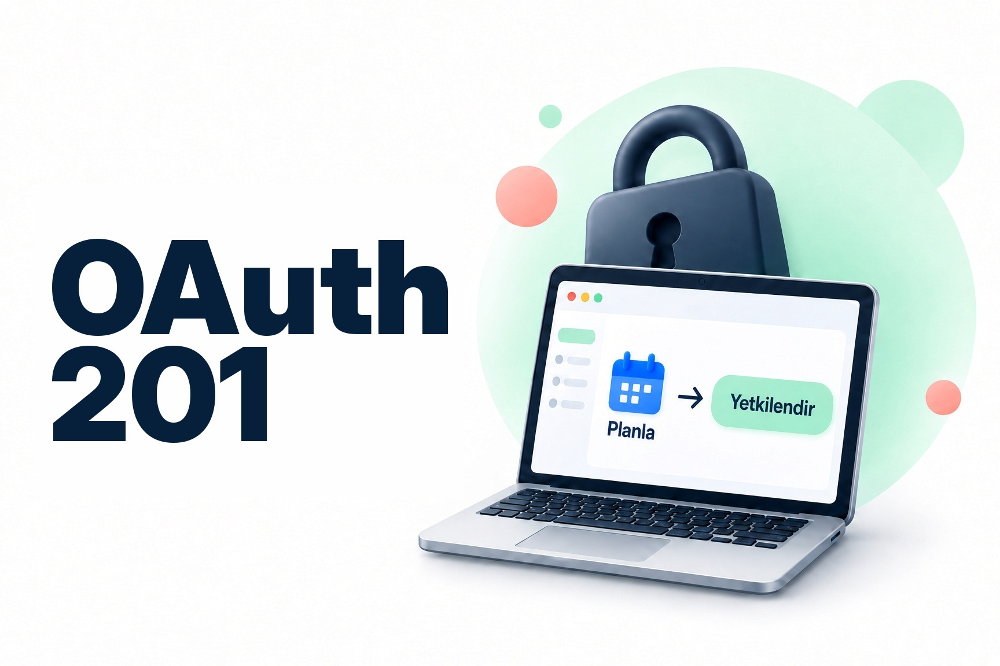

İlk yazıda OAuth’un neden var olduğunu ve Authorization Code akışını anlatmıştım. Bu yazıda o akıştaki güvenlik kontrolleri eksik olduğunda neler olduğuna bakıyorum. Sunucu ne kadar sağlam olursa olsun, istemci gelen kodu ve token’ı doğru kontrol etmezse kapı açık kalır.

Sık yapılan beş doğrulama hatasını kendi laboratuvarımda tek tek sömürüp ardından her birini nasıl kapattığımı anlatacağım. Bunların dördü istemci tarafında, biri (D1) ise yetkilendirme sunucusunun yapılandırmasında.

## 1. Authorization Code Akışı

Bu yazıdaki hataların çoğu OIDC tarafında, yani kullanıcının kimliğini taşıyan imzalı id_token’da ortaya çıkıyor. id_token’ı bir otel resepsiyonunun verdiği kart gibi düşünebiliriz. Kimliğini resepsiyona (Keycloak) gösterirsin, resepsiyon da sana yalnızca kendi odanı açan bir kart verir. Uygulama (Planla) kimliğini hiç görmez, sadece bu karta güvenir. Bu yazıdaki zafiyetlerin hepsi ya kartın yanlış kişinin eline geçmesiyle ya da kapının kartı yeterince dikkatli okumamasıyla ilgili.

Akışın adımları şöyle:

1. Kullanıcı Planla’ya gelir, Planla da onu yetkilendirme sunucusuna (Keycloak) yönlendirir.
2. Kullanıcı Keycloak’ta oturum açar. Keycloak onu, Planla’nın önceden kayıtlı `redirect_uri` adresine kısa ömürlü bir yetkilendirme koduyla (`code`) geri gönderir.
3. Planla bu kodu kendi `client_secret` değeriyle birlikte token uç noktasına gönderir ve karşılığında access_token ile id_token alır. Bu adım arka kanaldan (backchannel), yani tarayıcıya hiç uğramadan gerçekleşir.
4. Planla gelen id_token’ı doğrular ve içindeki kimlik bilgisiyle oturumu açar.

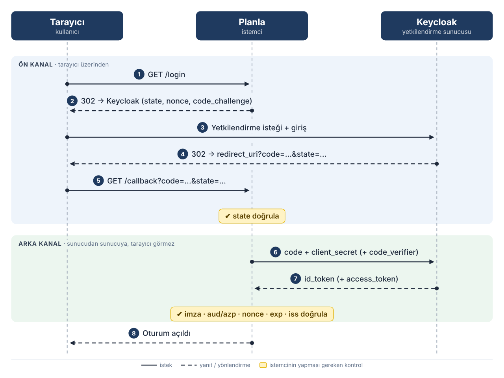

*Görsel 1. Authorization Code akışı: ön kanal tarayıcı üzerinden, arka kanal doğrudan Planla ile Keycloak arasında ilerliyor.*

Görsel 1’deki sarı kutular, istemcinin yapması gereken kontrolleri gösteriyor. Akışın güvenliği büyük ölçüde bu kontrollere bağlı, çünkü bir token’ın geçerli görünmesi onun bu istemci için ve bu oturumda üretildiği anlamına gelmez.

## 2. Laboratuvar Ortamı

- **Yetkilendirme sunucusu:** Keycloak 26.0.7, realm adı `oauth-lab`.
- **İstemci:** `planla`. Keycloak’ta confidential (`client_secret`’lı, gizli) istemci olarak kayıtlı. OIDC doğrulamalarını elle yapan, Flask ile yazılmış küçük bir uygulama.
- **Kullanıcılar:** `kurban` (`kurban@planla.lab`) ve `saldirgan` (`saldirgan@planla.lab`). İkisinin de parolası laboratuvar için sabit.
- **Güvenlik bayrakları:** Planla, istemci tarafındaki beş kontrolü bayraklarla açıp kapatabiliyor ve bunların durumunu her sayfanın sağ alt köşesindeki panelde gösteriyor:

| Bayrak | Görevi | İlgili zafiyet |
|---|---|---|
| `CHECK_STATE` | İsteği başlatan tarayıcı oturumunu geri dönen koda bağlar | **D2** — Login CSRF |
| `USE_PKCE` | Kod değişimini `code_verifier` ile oturuma bağlar | Ek koruma: başkasının başlattığı akıştan sızan kodun kullanılmasını engeller (bkz. 3.1, 3.2) |
| `VERIFY_AUDIENCE` | Token’ın bu istemci (aud / azp) için üretildiğini doğrular | **D3** — token substitution |
| `VERIFY_NONCE` | Token’ı tek bir login isteğine bağlar | **D4** — id_token replay |
| `VERIFY_SIGNATURE` | Token’ın gerçekten sunucudan geldiğini (imza) doğrular | **D5** — alg:none / sahte token |

D1 (redirect_uri doğrulaması) bu beş bayraktan biri değil. D1 tamamen Keycloak tarafındaki bir ayarla, istemcinin *Valid redirect URIs* alanıyla ilgili. Bu yüzden onu ayrı bir başlıkta, sunucu tarafı bir konu olarak ele alıyorum.

### 2.1. Token’ı uygulamaya nasıl verdim?

Planla’nın gerçek `/callback` uç noktası yalnızca `code` kabul ediyor. id_token’ı da kendisi, arka kanaldan token uç noktasından alıyor. Yani dışarıdan hazır bir id_token sokulabilecek gerçek bir kapı yok ve doğrusu da bu.

D3, D4 ve D5’te doğrulama katmanını (aud, nonce, imza) akışın geri kalanından ayırarak göstermek istedim. Bunun için laboratuvara `/lab/inject-id-token` adında bir test uç noktası ekledim. Bu uç nokta Planla’nın id_token doğrulama fonksiyonunu doğrudan çağırıyor. Gerçek bir üründe olmaması gereken bu kapı yalnızca laboratuvarda var ve ilgili ekran görüntülerini bunun üzerinden aldım.

Gerçek hayatta aynı doğrulama hataları başka yollardan sömürülür. Front-channel akışlarda (Implicit ya da `code id_token` yanıtı veren Hybrid) token doğrudan tarayıcıya düşer. SPA ve mobil mimarilerde id_token bir API’ye `Authorization: Bearer ...` başlığıyla taşınır. Sızmış ya da loglara düşmüş bir token da yeniden sunulabilir. Kısacası test uç noktası, gerçek saldırı yüzeyinin sadeleştirilmiş bir hâli.

## 3. Zafiyet Analizleri

### 3.1. D1 — redirect_uri Doğrulaması (Sunucu/IdP Tarafı)

redirect_uri, yetkilendirme bittiğinde kullanıcının gönderileceği callback adresidir ve istemci kaydedilirken yetkilendirme sunucusuna bildirilir. OAuth’un güncel güvenlik rehberi RFC 9700, sunucunun istekteki adresi kayıtlı değerle karakteri karakterine (exact string matching) karşılaştırmasını şart koşar. Bu kural gevşetilirse, örneğin Keycloak’taki *Valid redirect URIs* alanına joker (`*`) yazılırsa, yetkilendirme kodu saldırganın adresine gidebilir. Bu saldırının adı authorization code interception, yani kodun ele geçirilmesi.

Laboratuvarda `planla` istemcisi varsayılan olarak tam adrese (`http://127.0.0.1:5000/callback`) kayıtlı, yani güvenli. D1’i göstermek için bu alanı geçici olarak joker (`*`) yaptım.

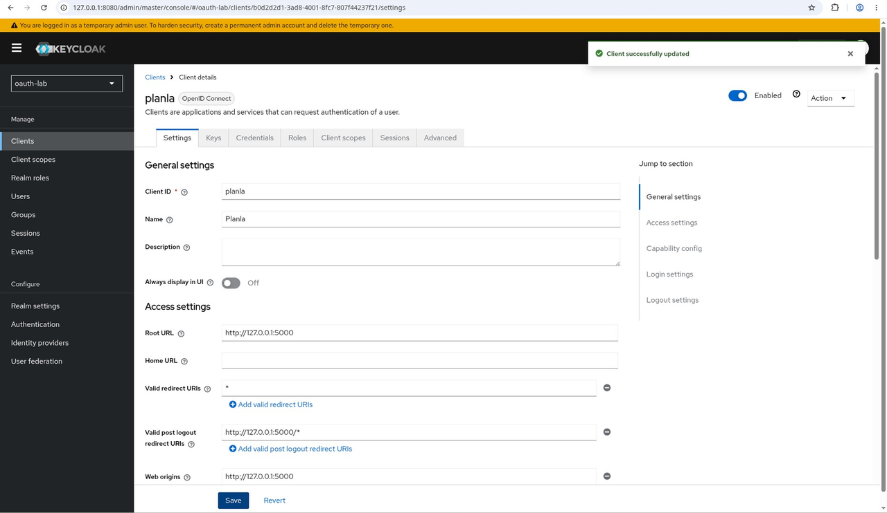

*Görsel 2. planla istemcisinin Valid redirect URIs alanı joker (`*`) ile değiştirilmiş hâli.*

**Sömürü:** Saldırgan kullanıcıya, redirect_uri değeri kendi sunucusunu gösteren bir yetkilendirme bağlantısı yollar. Kullanıcı giriş yaptığında Keycloak, joker eşleşmesi yüzünden kodu saldırganın adresine gönderir.

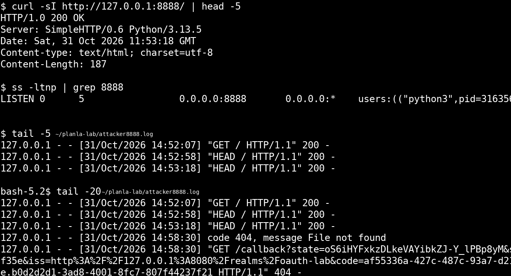

*Görsel 3. Saldırganın 8888 portundaki dinleyicisine düşen yetkilendirme kodu.*

Görseldeki adreste `code` ve `state`’in yanında bir de `iss` parametresi var. Bu parametre, kodu hangi yetkilendirme sunucusunun verdiğini bildirir ve birden çok IdP kullanan istemcileri mix-up saldırısına karşı korur.

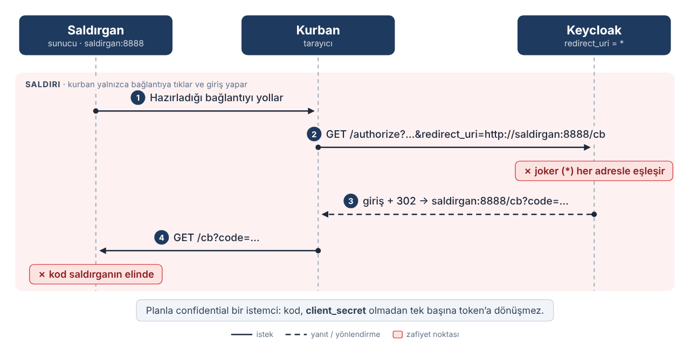

*Görsel 4. D1 saldırısı: joker redirect_uri yüzünden kod, kullanıcının tarayıcısı üzerinden saldırganın sunucusuna düşüyor.*

Kodun saldırgana düşmesi her zaman hesabın ele geçirilmesi anlamına gelmiyor, çünkü iki ayrı senaryo var. İlkinde saldırgan kodu token uç noktasında kendisi takas etmeye çalışır. Planla confidential bir istemci olduğu için `client_secret` olmadan bunu yapamaz. PKCE burada yardımcı olmaz; yetkilendirme isteğini saldırgan kurduğu için `code_verifier` da ondadır. Doğrudan takası durduran şey secret’tır.

İkinci senaryo kod enjeksiyonu ve burada secret işe yaramıyor. Saldırgan Planla’da kendi akışını başlatır, Planla’nın ürettiği `code_challenge`, `state` ve `nonce` değerlerini kullanıcıya gönderdiği bağlantıya kopyalar. Kullanıcının kodu eline geçince bu kodu kendi Planla oturumundaki callback’e verir. Takası Planla kendi secret’ıyla yaptığı için secret bir şey engellemez. Bu varyantı durduran, token uç noktasındaki redirect_uri bağlaması: Token uç noktası, kodu veren istekteki redirect_uri ile takastaki redirect_uri’nin aynı olmasını ister. Kod `saldirgan:8888` için verilmişti, Planla ise takasta `127.0.0.1:5000/callback` gönderiyor. Adresler eşleşmediği için takas reddediliyor.

Secret saklayamayan public istemcilerde (SPA, mobil) ise ilk senaryo doğrudan başarılı olur, çünkü saldırganı durduracak bir secret yoktur. Bu yüzden orada asıl savunma yine redirect_uri’nin tam eşleşmesi.

Benzer bir gerçek vaka CVE-2026-7504. Bu açık, *Valid redirect URIs* alanında joker içeren bir desen kullanan Keycloak istemcilerini etkiliyor. Java’nın URI ayrıştırıcısı, kullanıcı bilgisi (user-info) kısmında birden çok `@` işareti olan URL’leri yanlış ayrıştırıyor. Keycloak bu kısmı çözemeyince joker karşılaştırmasına düşüyor ve desenin dışında kalması gereken bir adrese yönlendirmeye izin veriyor. Açık 8.1 (yüksek) CVSS puanı aldı ve 26.6.2 sürümünde kapatıldı.

Ancak benim demom bu CVE’nin bir sömürüsü değil. CVE’nin asıl tehlikesi, `http://127.0.0.1:5000/*` gibi host’u sabit, yolu jokerli ve ilk bakışta güvenli görünen desenlerde ortaya çıkıyor; saldırı, desenin koyduğu host kısıtlamasını atlatıyor. Benim demomdaki çıplak `*` ise zaten her adresi kabul ediyor. Atlatılacak bir kural yok, ortada düpedüz bir yanlış yapılandırma var. Laboratuvardaki Keycloak 26.0.7 etkilenen sürüm aralığında olsa da demom CVE’deki çoklu `@` yolunu kullanmıyor. Joker, ister çıplak ister bir desenin içinde olsun, tam eşleşmenin yerini tutmuyor.

**Düzeltme:** *Valid redirect URIs* alanını tam callback adresine sabitledim. Tam eşleşme geri gelince aynı bağlantı daha en başta reddediliyor ve kod hiç üretilmiyor.

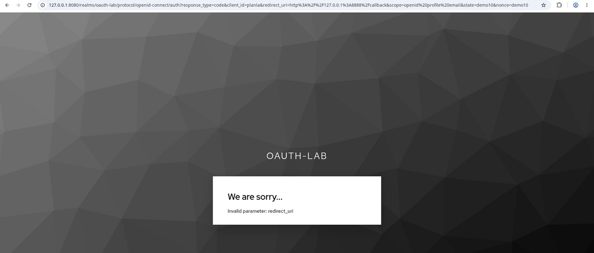

*Görsel 5. Adres sabitlendikten sonra Keycloak aynı saldırı bağlantısını reddediyor.*

### 3.2. D2 — Eksik state Doğrulaması: Login CSRF

state, yetkilendirme isteğini başlatan tarayıcı oturumunu geri dönen koda bağlayan, rastgele ve tahmin edilemeyen bir değerdir. Bu kontrol yoksa saldırgan kendi kodunu kullanıcının oturumunda kullandırabilir. Bu saldırıya Login CSRF ya da zorla hesap bağlama denir.

Planla’da kullanıcı, saldırganın hesabında olduğunu fark etmeden randevularını ve notlarını girer. Bunların hepsi saldırganın hesabına kaydolur, saldırgan da kendi hesabına girip hepsini okur. Kart bilgisi ya da dosya saklayan bir uygulamada zarar çok daha büyük olur.

**Oluşum:** `CHECK_STATE=false`. D2’yi yalnız bırakmak için `USE_PKCE` ve `VERIFY_NONCE` bayraklarını da kapattım, çünkü ikisi de oturuma bağlama yaptığından saldırıyı dolaylı yoldan engeller.

**Sömürü:** Saldırgan kendi akışını başlatır ve dönen kodu kullanmadan alır. Tarayıcı Keycloak’ın 302 yönlendirmesini anında takip ettiği için kodu araya girerek yakalamak gerekir. Bunun için Burp ya da ZAP gibi bir proxy kullanılabilir. Alternatif olarak tarayıcının geliştirici araçlarında `/callback` isteği *Network request blocking* ile engellenir. İstek Planla’ya ulaşmadığı için kod tüketilmez ve kodlu URL Network sekmesinde görünür. Ardından saldırgan bu kodu kullanıcıya gönderir. Kullanıcı bağlantıya tıkladığında state kontrol edilmediği için saldırganın kodu kabul edilir ve kullanıcı farkında olmadan saldırganın hesabıyla oturum açar.

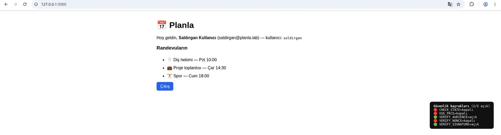

*Görsel 6. Kullanıcının tarayıcısı: Hoş geldin, Saldırgan Kullanıcı (`saldirgan@planla.lab`).*

Doğru kurulumda state değeri kriptografik olarak güçlü bir üreteçle (CSPRNG) üretilir ve oturumda HttpOnly, SameSite=Lax bir çerezle saklanır. Callback’te tek kullanımlıktır, yani kullanıldıktan sonra oturumdan silinir. Karşılaştırma da zamanlama saldırılarına kapalı bir yöntemle (`hmac.compare_digest`) yapılır. Planla değeri `secrets.token_urlsafe` ile üretiyor ve `session.pop` ile tek seferde tüketiyor. Çerezin SameSite=Lax olması Flask’ta varsayılan değil, bunu `SESSION_COOKIE_SAMESITE="Lax"` ayarıyla açıkça veriyorum:

```python
# /login
state = secrets.token_urlsafe(24)
session["oauth_state"] = state             # oturuma bağla (HttpOnly, SameSite=Lax çerez)

# /callback
state = request.args.get("state")             # Keycloak'tan dönen değer
exp_state = session.pop("oauth_state", None)   # tek kullanımlık
if not state or not hmac.compare_digest(state, exp_state or ""):
    raise VerifyError("state uyuşmuyor (olası CSRF)")
```

**Düzeltme:** `CHECK_STATE=true`. Kullanıcının oturumunda saldırganınkiyle eşleşen bir state olmadığı için callback reddediliyor.

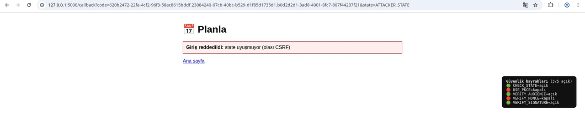

*Görsel 7. Giriş reddedildi: state uyuşmuyor (olası CSRF).*

PKCE’deki `code_verifier` ve OIDC’deki `nonce` da oturuma bağlıdır; bunlar açıkken saldırganın hazır kodu kullanıcının oturumuyla eşleşmez. state, PKCE ve nonce birbirini tamamlayan oturum bağlama kontrolleri ve güncel güvenlik rehberi en az birinin mutlaka bulunmasını şart koşuyor.

### 3.3. D3 — Eksik aud / azp Doğrulaması: Token Substitution

Geçerli imzalı bir id_token her zaman bu istemci için üretilmiş olmayabilir. Token’daki `aud` (audience) hedef istemciyi, `azp` (authorized party) ise token’ı talep eden tarafı gösterir. İstemci aud’u kendi `client_id` değeriyle karşılaştırmazsa, aynı sağlayıcının (Keycloak, Google, Azure AD…) başka bir uygulama için ürettiği geçerli bir token’ı da kabul eder. Buna token substitution denir.

OIDC Core’un ID token doğrulama kurallarına göre aud, istemcinin client_id değerini içermeli; token istemcinin güvenmediği ek audience’lar taşıyorsa da reddedilmeli. azp konusunda güncel metin daha esnek. Aralık 2023’te yayımlanan sürüm, çoklu audience’ta azp’nin varlığını doğrulamayı öneren eski maddeyi kaldırdı. Yani azp’yi doğrulamak artık spesifikasyonun dayattığı bir adım değil, istemcinin kendi politikası.

Burada imza sağlam, token sahte değil; sadece başka bir istemciye ait. İmza token’ın gerçek olduğunu gösterir, bu istemci için üretildiğini değil.

**Oluşum:** `VERIFY_AUDIENCE=false` iken planla, `baska-uygulama` için üretilmiş geçerli (RS256 imzalı) bir token’ı kabul ediyor. Bu demoda `VERIFY_NONCE`’u da kapalı tutmam gerekiyor, çünkü tarayıcıdaki giriş akışında nonce doğrulaması bu saldırıyı dolaylı yoldan durdurur. baska-uygulama için üretilmiş token, Planla’nın değil o uygulamanın giriş isteğine ait bir nonce taşır.

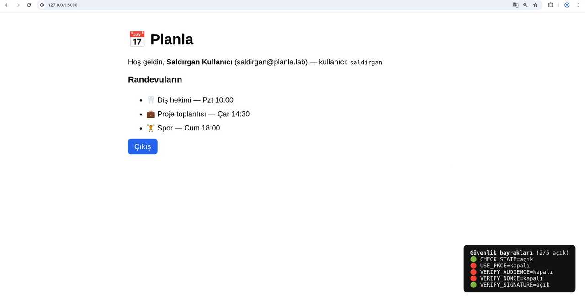

*Görsel 8. baska-uygulama için üretilmiş token kabul edildi. Panelde VERIFY_SIGNATURE açık, yani token gerçek imzalı; VERIFY_AUDIENCE ve VERIFY_NONCE kapalı.*

Görsel 8’de saldırgan kendi token’ıyla kendisi olarak giriyor. Bu, token’ın kabul edildiğini gösteriyor ama tek başına kimlik taklidi değil. Gerçekçi senaryoda saldırgan aynı IdP’de kendi istemcisini işletir ya da bir istemciyi ele geçirmiştir. Kullanıcı o uygulamaya giriş yapar, saldırgan da kullanıcının `aud=baska-uygulama` taşıyan token’ını Planla’ya sunar. aud kontrolü olmadığı için Planla token’ı kabul eder ve saldırgan kullanıcı olarak içeri girer. Görseldeki demo bu zincirin son adımını gösteriyor. Nonce’un bu saldırıyı durdurması ise tarayıcı akışına özgü. id_token’ın bir API’ye Bearer başlığıyla taşındığı mimarilerde nonce kontrolü yoktur ve geriye tek savunma olarak aud kalır.

Keycloak’ın id_token’ında aud normalde yalnızca client_id’dir; `account` gibi ek değerler access_token’da görünür. Yine de başka IdP’lerde ya da aynı kod access_token doğrulamak için kullanıldığında aud bir liste olabilir. O zaman “listede benim client_id’m var mı?” diye bakmak yetmez, listedeki her değerin güvendiğim bir audience olması gerekir. azp kontrollerini ise kendi politikam olarak ekledim. Bu katı tutum bazı IdP’lerle uyumsuzluk çıkarabilir, ama laboratuvarda güvenli tarafı seçtim:

```python
# Zayıf: sadece "var mı" bakar, ek audience'ları ve azp'yi yok sayar
# if client_id in auds: ...   # YETERSİZ

# Doğru:
TRUSTED_AUDS = {client_id}          # bu istemcinin güvendiği audience'lar

aud = claims.get("aud")
auds = aud if isinstance(aud, list) else [aud]
if client_id not in auds:
    raise VerifyError(f"aud uyuşmuyor: {aud}")
if not set(auds) <= TRUSTED_AUDS:   # OIDC Core: zorunlu
    raise VerifyError(f"güvenilmeyen audience: {set(auds) - TRUSTED_AUDS}")

# Aşağıdaki iki kontrol benim politikam (güncel OIDC Core'da zorunlu değil)
if len(auds) > 1 and "azp" not in claims:
    raise VerifyError("Çoklu audience (aud) var ancak azp claim'i eksik")
if "azp" in claims and claims["azp"] != client_id:
    raise VerifyError(f"azp uyuşmuyor: {claims.get('azp')}")
```

**Düzeltme:** `VERIFY_AUDIENCE=true`. Aynı token artık reddediliyor.

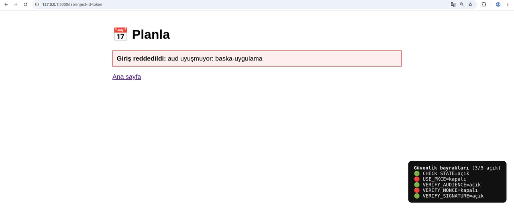

*Görsel 9. Giriş reddedildi: aud uyuşmuyor: baska-uygulama. Token’ın imzası hâlâ geçerli, ancak audience yanlış olduğu için kabul edilmiyor.*

### 3.4. D4 — Eksik nonce Doğrulaması: id_token Replay

nonce, istemcinin `/login` sırasında üretip oturuma yazdığı rastgele bir değerdir. Yetkilendirme sunucusu bu değeri id_token’a koyar, istemci de dönen token’daki nonce ile oturumdakini karşılaştırır. Böylece token tek bir giriş isteğine bağlanır. state tarayıcı akışını bağlıyordu; nonce ise doğrudan id_token’ın kendisini o girişe bağlar. Bu kontrol yoksa bir kez ele geçirilen geçerli bir id_token başka bir oturumda yeniden oynatılabilir (replay).

Senaryoyu şöyle kurdum. Önce kullanıcı normal şekilde giriş yapıyor. Planla `/login` sırasında bir nonce (N1) üretiyor ve Keycloak dönen id_token’a `nonce=N1` yazıyor. Saldırgan bu token’ı bir yerden, örneğin loglardan, Referer başlığından ya da tarayıcı geçmişinden ele geçiriyor. Sonra kendi taze oturumunda, yani `nonce=N2` üretilmiş bir oturumda, token’ı yeniden sunuyor.

- `VERIFY_NONCE=false`: Planla nonce’a bakmıyor. Token kabul ediliyor ve saldırgan kullanıcının kimliğiyle içeri giriyor. Replay başarılı.

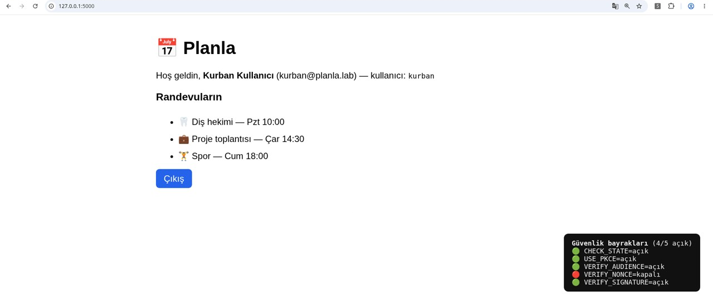

*Görsel 10. VERIFY_NONCE kapalı. Kullanıcının nonce taşıyan gerçek id_token’ı taze bir oturumda yeniden oynatıldı ve kullanıcı olarak giriş yapıldı.*

- `VERIFY_NONCE=true`: Token’daki nonce (N1) oturumdaki nonce (N2) ile eşleşmiyor ve token reddediliyor.

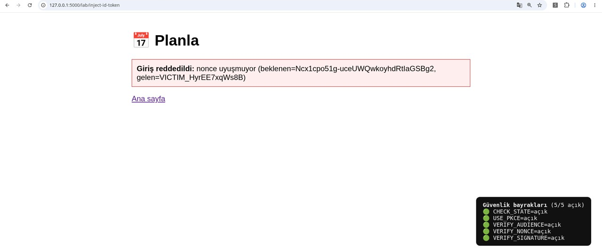

*Görsel 11. Giriş reddedildi: nonce uyuşmuyor (beklenen=N2, gelen=N1). Laboratuvar script’i kullanıcının nonce’una okunabilirlik için `VICTIM_` ön ekini ekliyor, hata satırındaki gelen değer bu yüzden böyle görünüyor. Token gerçek bir nonce taşıyor, ancak oturumun beklediği değerle eşleşmediği için replay reddediliyor.*

Doğrulama kodu D2 ile aynı yaklaşımı kullanıyor: tek kullanımlık tüketim ve `hmac.compare_digest`. Böylece `None == None` tuzağına da düşülmüyor:

```python
session_nonce = session.pop("oauth_nonce", None)  # tek kullanımlık tüketim
token_nonce = claims.get("nonce")
if (not session_nonce or not token_nonce
        or not hmac.compare_digest(session_nonce, token_nonce)):
    raise VerifyError(
        f"nonce uyuşmuyor (beklenen={session_nonce}, gelen={token_nonce})"
    )
```

Nonce doğrulaması yoksa tek seferlik bir sızıntı (log, tarayıcı geçmişi, proxy, hatalı yönlendirme), token’ın süresi dolana kadar sınırsız yeniden kullanıma dönüşür.

### 3.5. D5 — Eksik İmza Doğrulaması: alg:none ve Sahte Token

id_token, yetkilendirme sunucusunun özel anahtarıyla imzalanmış bir JWT’dir. İstemci bu imzayı sunucunun açık anahtarıyla (JWKS) doğrulamazsa ya da imzasız (`alg:none`) token’ları kabul ederse, saldırgan hiçbir anahtar ya da secret olmadan, gerçek bir giriş bile yapmadan sıfırdan token uydurabilir. Bunu, mührü ve hologramı olmayan, evde elle yazılmış bir kimlik kartı gibi düşünebilirsin: Üzerinde “Adı: Yönetici” yazıyor ve kapıdaki görevli mühre hiç bakmadan seni içeri alıyor.

JWT güvenlik rehberi RFC 8725 bu konuda net: alg değerine körü körüne güvenilmemeli, imza doğrulanmalı, izin verilen algoritmalar beyaz listeye alınmalı ve `none` reddedilmeli. Bu zafiyet D3’ten de ağır, çünkü D3’te en azından başka bir uygulamaya ait gerçek imzalı bir token gerekiyordu. Burada hiçbir şeye gerek yok.

**Oluşum:** `VERIFY_SIGNATURE=false` iken başlığı `{"alg":"none","typ":"JWT"}` olan ve imza bölümü boş bırakılmış (`header.payload.` biçiminde, sonda tek nokta) token’lar kabul ediliyor. Bu demoda kapattığım bayrak `VERIFY_SIGNATURE`. `CHECK_STATE`, `USE_PKCE` ve `VERIFY_AUDIENCE` açık, `VERIFY_NONCE` ise D4’ten kapalı kaldı. Nonce açık olsaydı da sonuç değişmezdi, çünkü saldırgan kendi tarayıcı oturumundaki nonce’u bilir. Flask’ın varsayılan session’ı imzalı ama şifresiz bir çerez olduğu için saldırgan çerezi base64 ile çözüp (çerez sıkıştırılmışsa, yani başında nokta varsa, önce zlib ile açıp) nonce’u okuyabilir ve uydurduğu token’a yazabilir. Yani buradaki asıl savunma tek başına imza kontrolü.

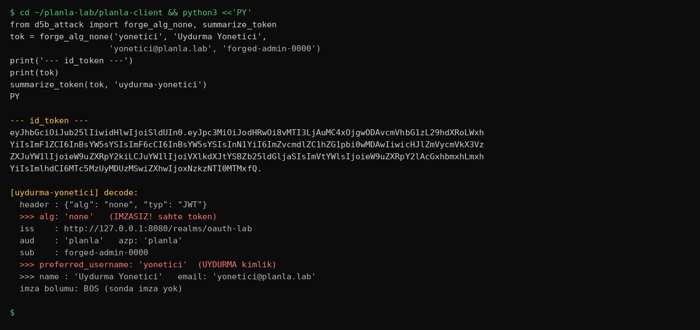

*Görsel 12. Terminalde imzasız alg:none token. Hiçbir anahtar kullanılmadı, payload’a `preferred_username=yonetici` yazıldı.*

**Sömürü:** `preferred_username` alanına ne yazarsan kimliğin o oluyor. Laboratuvarda var olmayan bir `yonetici` (Uydurma Yönetici) kimliği uydurup enjekte ettiğimde token yine kabul edildi:

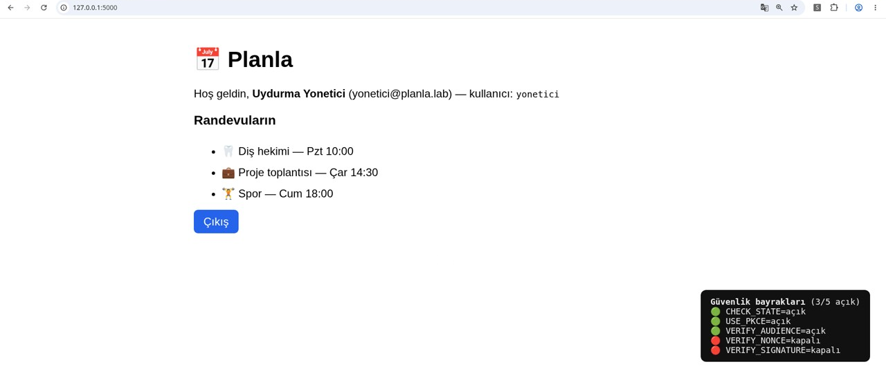

*Görsel 13. İmza kontrolü kapalıyken tamamen uydurma yonetici (`yonetici@planla.lab`) kimliğiyle giriş yapıldı. Panel: 3/5 açık (VERIFY_SIGNATURE kapalı, VERIFY_NONCE ise D4’ten kapalı kaldı). Burada sistemde yeni bir hesap oluşturulmuyor; var olmayan bir kimlik iddiası imzasız token’a yazılıyor ve uygulama buna güveniyor.*

İmza doğrulama hataları alg:none ile sınırlı değil; iki yakın akrabası var. Birincisi algoritma karışıklığı (RS256→HS256): Uygulama algoritmayı token’ın alg başlığından okuyorsa saldırgan, sunucunun açık RSA anahtarını HMAC gizli anahtarı gibi kullanarak geçerli bir HS256 imzası üretebilir. İkincisi başlıktaki anahtar göstergelerinin kötüye kullanılması. `jku` ve `jwk` başlıklarıyla saldırgan anahtarın kendisini enjekte eder, yani kendi anahtarını gösterip imzayı doğrulatır. `kid` ise anahtarı taşımaz, hangi anahtarın seçileceğini belirler. Uygulama kid değerini dosya yolu ya da veritabanı sorgusunda kullanıyorsa path traversal veya SQL enjeksiyonuyla anahtar seçimi manipüle edilebilir.

İkisinin savunması da aynı: Algoritmayı token’dan değil sunucu yapılandırmasından sabitlemek ve anahtarı yalnızca güvenilen JWKS uç noktasından almak. Planla bunu `algorithms=["RS256"]` ile ve anahtarı yalnızca yapılandırılmış JWKS’ten alarak yapıyor:

```python
# ZAFİYET: imzaya hiç bakma
claims = jwt.decode(tok, options={"verify_signature": False})

# DOĞRU: JWKS anahtarı + sabit algoritma + iss/aud/exp
# (aud'yu burada da doğrulayabilir veya D3'teki manuel kontrole bırakabilirsin)
jwks_client = jwt.PyJWKClient(JWKS_URL)   # Keycloak .../protocol/openid-connect/certs
key = jwks_client.get_signing_key_from_jwt(tok).key
claims = jwt.decode(
    tok,
    key,
    algorithms=["RS256"],          # alg token'dan ALINMAZ; none reddedilir
    audience=client_id,            # PyJWT InvalidAudienceError'ı önler / aud doğrular
    issuer=EXPECTED_ISSUER,        # diyagramdaki iss kontrolü
    options={"require": ["exp", "iss", "aud"]},
)
```

**Düzeltme:** `VERIFY_SIGNATURE=true`. Diğer bayraklara dokunmadığım için panel 4/5 açık gösteriyor ve aynı sahte token artık reddediliyor.

Bu adımda bir yanılgıya düştüm. İlk çektiğim ekran görüntüsünde hata `Unable to find a signing key that matches: "None"` çıktı ve algoritma kontrolünün çalıştığını sandım. Sonra token’ın oraya hiç ulaşmadığını fark ettim. Sahte token’da `kid` başlığı olmadığı için `PyJWKClient` anahtar aramasında takılıyor, `algorithms=["RS256"]` satırına hiç gelinmiyordu. Sahte token’a RS256 anahtarının gerçek kid değerini ekleyip tekrar denediğimde token `jwt.decode` adımına geldi ve bu kez gerçekten alg değeri beyaz listede olmadığı için reddedildi.

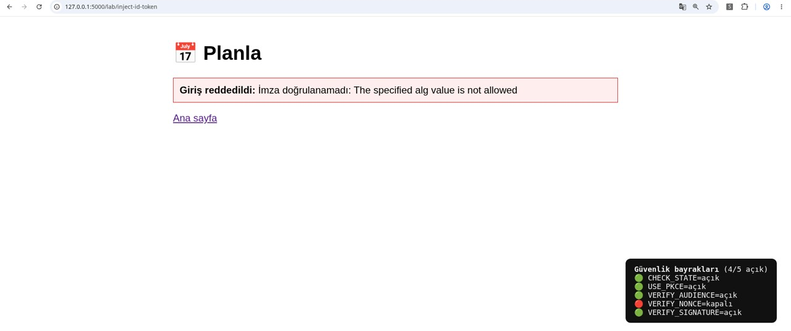

*Görsel 14. Giriş reddedildi: İmza doğrulanamadı: The specified alg value is not allowed. Anahtar (kid) bulundu, ancak token’ın alg değeri beyaz listede olmadığı için reddedildi. Panel 4/5: Dört bayrak açık, yalnızca nonce kapalı.*

## 4. Laboratuvarın Sınırları

Demoları okunur tutmak için bazı yerlerde kestirmeden gittim. Gerçek bir kurulumda bunların farklı olması gerekiyor:

- Planla, state ve nonce’u Flask’ın varsayılan session’ında tutuyor. `session.pop` değeri yeni çerezden siler, ama bu session istemci tarafında, çerezin içinde durduğu için eski çerezi elinde tutan biri değeri yeniden kullanabilir. Gerçek tek kullanımlık için Flask-Session ya da Redis gibi sunucu tarafı bir session gerekir.
- Nonce hata mesajında beklenen değeri okunabilirlik için açık bıraktım. Gerçek bir üründe bu ayrıntı loga yazılmalı ve kullanıcıya genel bir hata mesajı dönmeli; aksi hâlde hata sayfası beklenen değeri ifşa eder.
- Her şey `127.0.0.1` üzerinde, düz http ile çalışıyor. Gerçek kurulumda tüm uç noktalar TLS arkasında olmalı; yoksa kod ve token’lar ağda açıkta taşınır.
- `/lab/inject-id-token` uç noktası yalnızca doğrulama katmanını göstermek için var (bkz. 2.1). Gerçek bir üründe böyle bir kapı olmamalı.

## 5. Özet Tablo

| Kod | Katman / Bayrak | İlgili Standart | Etki | Savunma |
|---|---|---|---|---|
| D1 | Keycloak *Valid redirect URIs* (IdP) | RFC 9700 §2.1, §4.1; RFC 6749 §4.1.3; RFC 3986 §6.2.1; CVE-2026-7504 | Kod ele geçirme; public istemcide ya da implicit/hybrid akışta hesap devralma | Tam dizge eşleşmesi |
| D2 | `CHECK_STATE` | RFC 9700 §4.7; RFC 6749 §10.12 | Login CSRF / zorla hesap bağlama | Tek kullanımlık, oturuma bağlı state |
| D3 | `VERIFY_AUDIENCE` | OIDC Core §3.1.3.7; benzer: RFC 9700 §4.10.2 | Kimlik taklidi (token substitution) | aud’da client_id var, güvenilmeyen ek audience yok; azp = client_id (politika) |
| D4 | `VERIFY_NONCE` | OIDC Core §3.1.3.7; RFC 9700 §4.5.3.2 | id_token replay | Oturum nonce’uyla eşleştirme |
| D5 | `VERIFY_SIGNATURE` | RFC 8725 §2.1, §3.1 | Tam kimlik doğrulama atlatma | JWKS imza + sabit algoritma, none yok |

## 6. Sonuç

Beş zafiyetin kökünde aynı yanılgı var: Geçerli görünen bir girdiye doğrulamadan güvenmek. D1 kodun doğru yere gitmesini, D2 akışın doğru oturumla başlamasını, D3 token’ın doğru uygulama için üretilmiş olmasını, D4 token’ın tek bir girişe bağlı olmasını, D5 ise token’ın gerçekten sunucudan gelmesini sağlıyor. Bunlardan biri eksikse diğerleri yerinde olsa bile kimlik doğrulama çökebilir. Özellikle imza (D5) ve audience (D3) eksikliği tek başına hesabın tamamen ele geçirilmesine yetebilir. İmzasız ya da zayıf imzalı token’ları kabul etmek, OWASP API Security Top 10’daki API2:2023 Broken Authentication sınıfında açıkça sayılan örneklerden biri.

Pratikte önerim, OIDC doğrulamasını elle yazmak yerine bu kontrolleri (redirect_uri eşleşmesi, state, PKCE, nonce, aud/azp, imza) varsayılan olarak yapan olgun bir kütüphane kullanman. Elle yazmak zorundaysan beş kontrolün her birini ayrı ayrı test et. Diyagramdaki exp ve iss kontrolleri de en az bunlar kadar şart. iat ise çok eski token’ları reddetmek için kullanılabilecek isteğe bağlı bir kontrol; kabul edilebilir aralığı istemci belirler. Bunlar için ayrı bir demo yapmadım, ama D5’teki kodda iss ve exp zorunlu tutuluyor.

Serinin ikinci yazısında aynı akışa bu kez yetkilendirme sunucusu tarafından bakacağız.

## Kaynaklar

- RFC 9700 — Best Current Practice for OAuth 2.0 Security (§2.1, §4.1, §4.2–§4.3, §4.5 ve §4.5.3.2, §4.7, §4.10.2)
- RFC 6749 — The OAuth 2.0 Authorization Framework (§4.1.3, §10.12)
- RFC 7636 — Proof Key for Code Exchange (PKCE)
- RFC 8725 — JSON Web Token Best Current Practices (§2.1, §3.1)
- RFC 9207 — OAuth 2.0 Authorization Server Issuer Identification
- RFC 3986 — Uniform Resource Identifier (URI): Generic Syntax (§6.2.1)
- OpenID Connect Core 1.0, errata set 2 (Aralık 2023) — §3.1.3.7 ID Token Validation
- CVE-2026-7504 — Keycloak wildcard redirect URI open redirect / validation bypass (CWE-601, CVSS 8.1, 26.6.2’de düzeltildi); NVD ve Corgea advisory kayıtları
- OWASP API Security Top 10 (2023) — API2:2023 Broken Authentication
